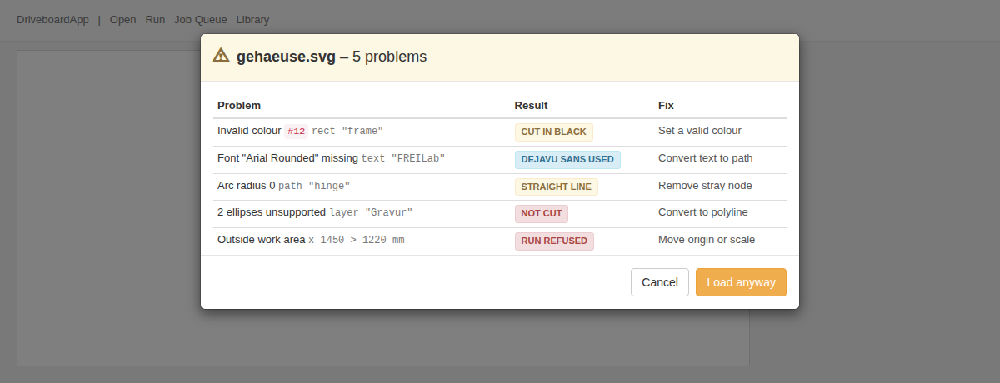
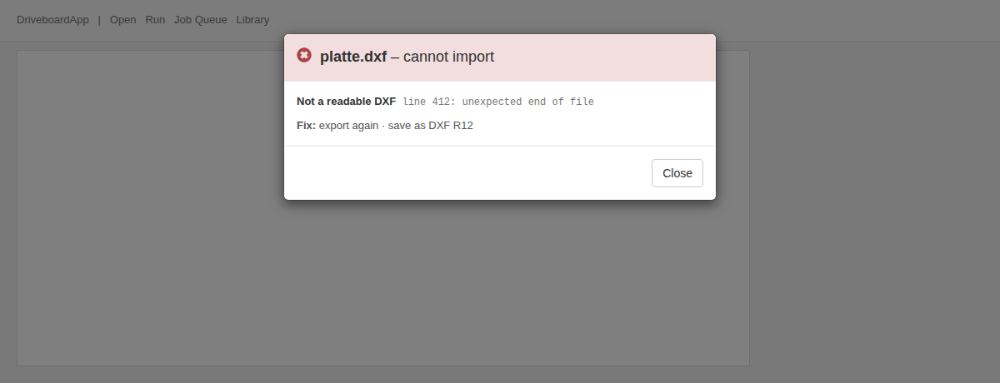

# Import issues dialog

## Why

Import problems today show up as cryptic toasts (or only in the server log),
and then the import either silently goes ahead or silently does nothing. The
operator can't tell what went wrong, nor what the machine will actually cut.

Goal: every import problem is shown in plain words, together with what the app
does about it, before anything is queued. The operator then cancels or loads
anyway.

## What the operator sees

**Problems, file still loadable** — modal before the job reaches the queue.
One row per problem:

| Column | Content | Example |
|---|---|---|
| Problem | short text + location (element id, layer, line) | Invalid colour `#12` `rect "frame"` |
| Result | coloured label: what the app does | CUT IN BLACK / DEJAVU SANS USED / STRAIGHT LINE / NOT CUT |
| Fix | 2–4 words, what to change in the source file | Set a valid colour |

Buttons: **Cancel** · **Load anyway**.

**File not loadable** — modal with problem, location/numbers, short fix list.
Button: **Close**.

**No problems** — no dialog, import behaves exactly as today.

## Decided

- Laser frontend (`frontend/`) only. Mill frontend unchanged.
- UI text in English, like the rest of the app. Short, no prose.
- Covers every import format: SVG, DXF, G-code, images (incl. image data
  inside SVG), and the converter/optimizer steps.
- Nothing is written to the queue until the operator chooses **Load anyway**.
  Cancel leaves the queue untouched (no temporary entry, no queue trimming
  of old jobs caused by a cancelled import).
- Result labels, three kinds, colour-coded:
  - *changed but cut* (yellow) — e.g. default colour, straight line instead of arc
  - *replaced* (blue) — e.g. fallback font
  - *not cut* (red) — content dropped
- Same problem repeated many times collapses to one row with a count
  (`2 ellipses unsupported`).
- **Work-area check for every format** (operator's decision): after
  conversion the job is checked against the work area the same way a run
  checks it (`job_laser_validate` in `driveboard.py`), with the current job
  origin. Outside → a *warning* row `Outside work area` / RUN REFUSED (red) /
  `Move origin or scale`, not a blocker. The DXF importer's existing
  out-of-bounds error becomes this warning too.

### Builder's calls (made by Claude, check while reading)

- **Opt-in, backward compatible.** The laser frontend sends
  `review_issues: true` with `/load`. Without it `/load` behaves exactly as
  today (mill frontend, scripts, existing tests unchanged).
- **Every import failure goes through the fatal dialog:** today's 422
  (`ValueError`), 400 "Invalid file type" (`TypeError`), DXF `RuntimeError`s
  (today an unhandled 500), and the 504 timeout. Each gets a problem text and
  a fix.
- **Fatal plus warnings:** only the fatal issue is shown. Warnings collected
  before the parser gave up are partial and would mislead.
- **Progressive load:** the dialog appears after the quick parse, with the
  issues from parsing. The parsed job is held server-side under the existing
  load token while the optimizer keeps running. *Load anyway* commits it to
  the queue (the optimized result replaces it when ready, as today). *Cancel*
  discards the held job and its pending optimize. Held jobs not decided on
  expire after `CONVERT_TIMEOUT`.
- **Optimizer-stage messages** (e.g. an invalid `fill_mode` sent by the
  frontend) are about request parameters, not the file. They stay as toasts,
  outside the dialog.

## Goals

- Every warning/error the importers can produce today (`log.warn`,
  `log.warning`, `log.error`, `print("WARN…")`, `print("ERROR…")`, raised
  `ValueError`s that end as HTTP 422) becomes a structured issue with
  problem, location (when known), result and fix — or is dropped if it is
  pure debug noise the operator can't act on.
- Fatal errors (today: 422 with a raw message) return the same structure
  and show the fatal dialog.
- Issues are collected per import, not in module globals (imports may run
  concurrently; the existing `_conversion_warnings` global in
  `svg_text_converter.py` is replaced).

## Non-goals

- Mill frontend.
- Run-time warnings from `driveboard.py` (lead-in clamping, raster limits).
- Fixing the underlying limitations (G2/G3 arcs, DXF ellipses/POLYLINE stay
  unsupported — they just get reported properly).
- Loading from the library or re-posting an already converted dba (run
  button path): no new dialog there.

## Anti-goals

- A dialog that is a wall of text. If a row needs a sentence, it is wrong.
- Any import that changes or drops geometry *without* showing a row.
- A cancelled import that leaves anything behind in the queue.

## Constraints

- Backend: Python 3.9+, bottle, conversion runs in a worker process
  (`_convert_job` / `_convert_worker` in `backend/web.py`) and supports a
  progressive load (quick parse returned first, optimized job later via
  `/load_result/<token>`). Issues must survive that process boundary.
- Frontend: jQuery + Bootstrap 3 already loaded; plain JS, no new libraries.
- Existing tests must keep passing; new behaviour gets tests
  (backend: issue structure per importer, `/load` without/with acceptance,
  fatal path; frontend: `node --test frontend/tests`).

## Left to the builder

- Issue data shape and where the collector lives (suggestion:
  `{"problem", "where", "result", "label", "fix", "count"}` plus
  `"fatal": true` for blocking ones).
- Endpoint names and shape for commit/cancel of a held job (within the
  calls above).
- Exact wording of each row, within the length rule above.
- Whether `job.head.warnings` stays in the dba or is removed once the dialog
  replaces the toast.
